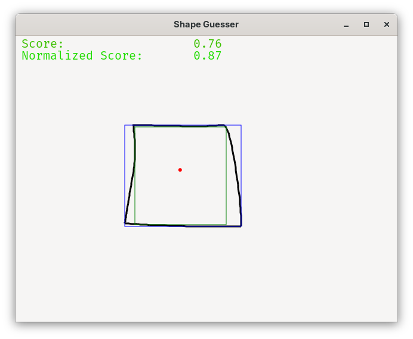
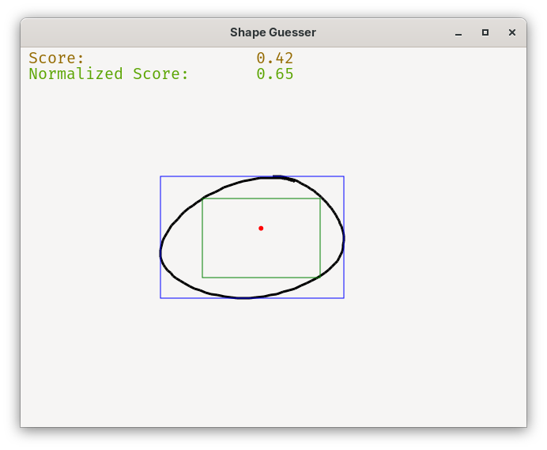

# Shape Guesser

'Native' python program that scores the 'rectangle-ness' of the shape you draw

## Installation / Usage

requires the uv package manager

```sh
git clone git@github.com:DigitalHungerTM/shape-guesser.git
cd shape-guesser
uvx briefcase dev -r
```

## Screenshots




